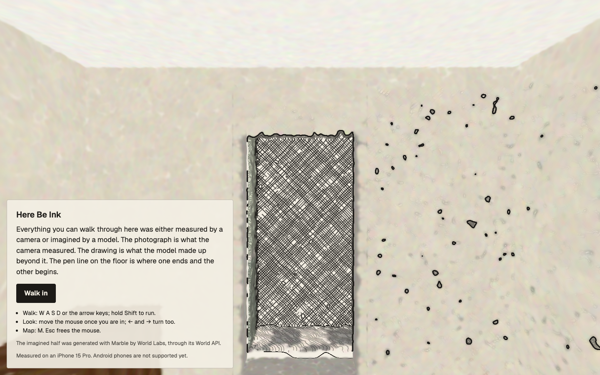
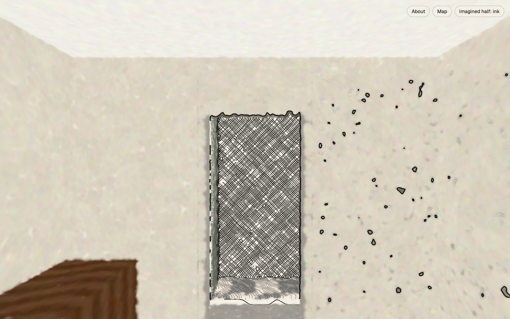
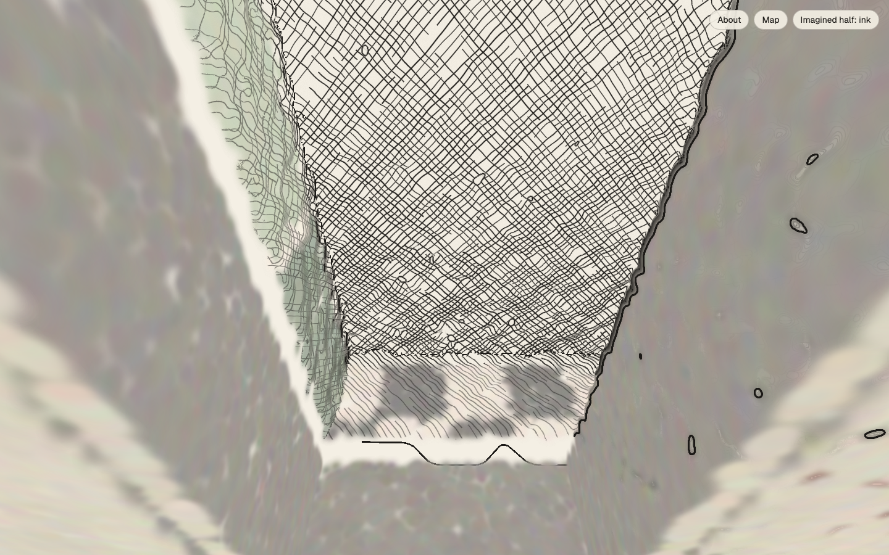
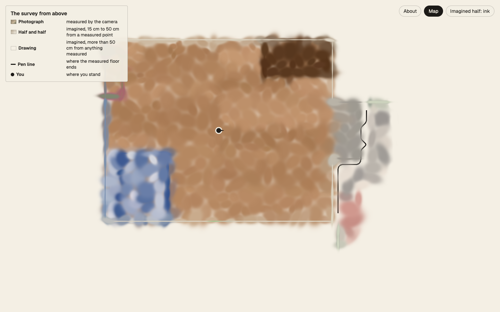
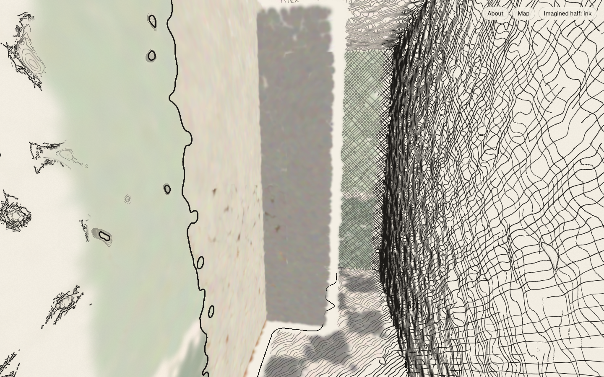
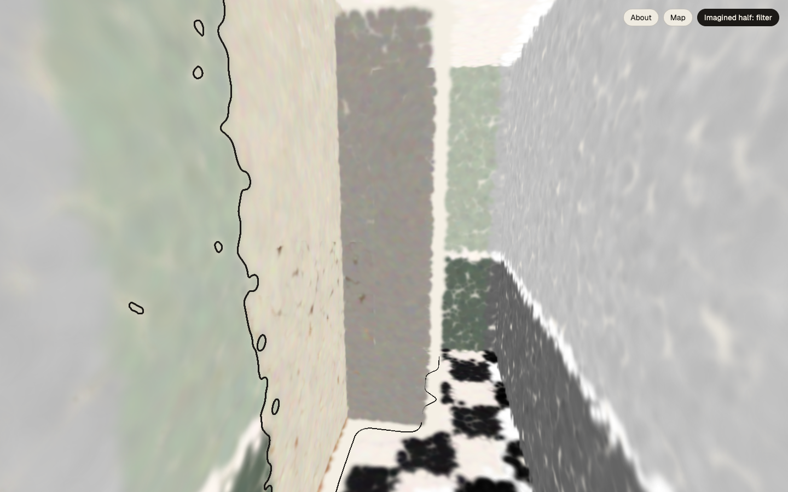

# The viewer on the fixture (18 Nov 2026)

The page in `web/` (`index.html`) on the synthetic fixture world in `web/public/fixture/`: a 4 m × 3.2 m box room as the measured splat and a Marble-like world of it with an invented hallway beyond the door, run through the real pipeline. No capture is in these pictures. Spark 2.4.0, three.js 0.187.0, Chromium headless on a MacBook Air M5 (`ANGLE Metal Renderer: Apple M5`), 1440 × 900 at DPR 1. Made by `web/tools/viewer-measure.mjs all`; the raw numbers are in [`numbers.json`](numbers.json).

| | |
|---|---|
|  |  |
| **First screen**: the statement, Walk in, the controls, the credit, the phone line. | **The room side** at scene.json's start pose. |
|  |  |
| **Across the coastline**, looking down past the door: the photographed passage, the floor line where the measured floor ends, the drawn hallway beyond. | **The map**: the shade pass from above with the ceiling cut at 1.2 m, the coastline, the legend with the two radii, the visitor. |
|  |  |
| **The ink side looking back** towards the measured passage. | **`?ink=off`** at the same pose: the plain desaturate-and-contrast filter, no outlines or hatching. |

## How the ink reads, honestly

- **Where it works:** surfaces facing the viewer at a moderate angle (the hallway's far wall in *across*) read as cross-hatched pen work: separate strokes with paper between them, tone carried by how many strokes there are, each stroke with its own drift, weight and pen lifts so the field does not read as a printed screen. Against the filter at the same pose (05) it is plainly a drawing, not a tint.
- **Where it does not yet:** walls seen at a grazing angle (the right wall in 03) get dense, wavy strokes: the world position is rebuilt from blended splat depth, and its noise is magnified along the wall. Overlap surfaces (the green wall, provenance ½) show the photo through half-strength hatching and read more like a tinted photograph than either half. The fixture's sparse walls have pinholes, and where the hallway shows through a hole in a measured wall the hole gets an outline (the specks on the right of 01). Outlines are few: the fixture's soft geometry gives almost no creases at the 2 % depth / 20° normal thresholds, so the hallway is carried by hatching and silhouettes.
- **Not decided here:** Gate D ("drawing or filter") is Aaron's on the real capture. Real trained walls are denser than the fixture's, so the pinholes and the depth noise may both shrink; the thresholds and hatch spacing are in `web/src/ink/pen.ts` for the design pass.

## Numbers

**Outline width** (Playwright, SwiftShader, 720 × 450, `?debug=edges&coast=off`, the *across* pose): 2.04 CSS px at DPR 1 by the spike's crossing method (152 crossings). At DPR 2 and 3 the ink area per CSS px² is 0.999 and 1.000 of DPR 1's, so the lines keep their CSS width (lines of a fixed device width would give 0.5 and 0.33). The crossing method itself reads 1.35 and 1.33 CSS px there: the fixture's outlines break into dashes and the method undercounts a dash's width once it spans more device pixels; the spike's butterfly had clean contours and did not show this.

**Frame time** (real GPU, vsync off, the camera swaying so Spark re-sorts every frame, ink passes off and on interleaved 1.5 s each over eight cycles, median of the paired differences; 213,326 splats drawn, LoD on with the 1.5M desktop budget):

| Canvas | Pose | Shade only | With the ink pass | Cost of the ink pass |
|---|---|---|---|---|
| DPR 2 (data passes ×½) | ink side looking back | 10.43 ms | 16.00 ms | **6.89 ms** |
| DPR 2 (data passes ×½) | across | 5.76 ms | 11.35 ms | **5.52 ms** |
| DPR 1 (data passes ×1) | ink side looking back | 3.18 ms | 7.97 ms | **5.30 ms** |

The spike's second pass cost 4.0 ms at DPR 2 with half-resolution data. The product pass costs more because it adds two blur passes and a full-resolution present (hatching from the G-buffer, five extra taps for the normal); at the hatched pose it is over the spike's 6 ms bar. Cheaper routes, in order: hatching normals from one tap instead of five; the blur at half the data resolution; then the spike's route 1 (one splat pass with two outputs), which removes a generate, a sort and a draw.

**First splats** (Playwright, 4G profile of 9 Mbit/s down, 1.5 up, 85 ms): the preview is in 538 ms after the scene request; splats are on screen 2.16 s after it under SwiftShader and about 0.65 s on the real GPU. The JS bundle is 1.12 MB gzipped (Spark is most of it), about 1 s more on that line, so the 2 s criterion is tight on 4G and needs the phone's own measurement.
